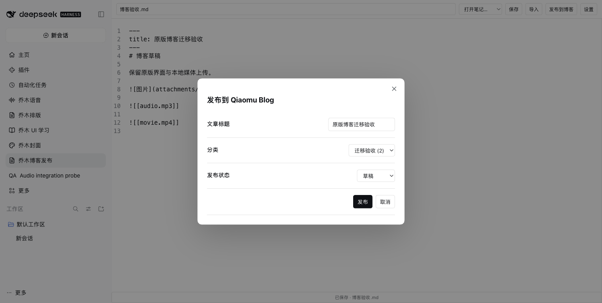

# Qiaomu Blog Publisher for DeepSeek Harness

> v0.1.1: DeepSeek Harness **0.2.1-rc.3** compatibility update. [Release verification](docs/RC3-COMPATIBILITY.md).

[中文](README.md)

Publish Markdown to your own Qiaomu Blog using the original publisher dialog and settings UI. Local images, audio and video upload to the blog's R2 storage; remote images are downloaded and re-uploaded through the original API.



## Install

Requires Harness `0.2.1-rc.3` (`<0.3.0`) and Node.js 22+. Download the tgz and SHA256SUMS from [Releases](https://github.com/joeseesun/qiaomu-blog-publisher-dsh/releases), verify the checksum, then install in plugin management or run:

```sh
dsh plugin --profile desktop add /absolute/path/qiaomu-blog-publisher-dsh-0.1.1.tgz
```

Open Qiaomu Blog Publisher, import Markdown, enter your blog URL and API token in Settings, and open the publishing dialog. Draft is the default; choosing Published makes the article public. Title priority is frontmatter, first H1, then filename. The original category, progress, success, retry and browser editing controls are retained.

## Workspace and migration

Notes default to `$DSH_HOME/qiaomu/qiaomu-blog-publisher-dsh/notes` (`~/.dsh` without DSH_HOME). Optional absolute `notesDir` and `dataDir` configuration selects the workspace and state location. Notes are limited to 2 MB, attachments to 32 MB. Child symlinks are refused, and version-aware saves protect external edits.

Import supports Markdown, media and the original plugin's `data.json`. Imported media goes to `attachments`; retain matching relative paths or select an existing complete directory as notesDir. Tokens migrate to macOS Keychain, Windows DPAPI or Linux Secret Service, without deleting the original data. Linux requires `secret-tool` and Secret Service. State JSON stores no API token.

Requires the original [Qiaomu Blog API](https://github.com/joeseesun/qiaomu-blog-opensource). As in the original plugin, media failures do not prevent post creation; inspect reported failures and links before publishing publicly.

## Validation

Tests exercise the original workflow through a real local HTTP fixture, covering categories, multipart images/audio/video, remote images, repeated embeds, titles, API errors, persistence conflicts and host boundaries. No real blog or R2 account received test content. Windows/Linux credential implementations have not been exercised on those operating systems. See [ADAPTATION](docs/ADAPTATION.md).

```sh
npm ci
npm run check
npm pack
```

MIT. Original source frozen at `5d41358f707320c2f56016bf62327eb60d8668b8`; actual bundled licenses are listed in [THIRD_PARTY_NOTICES](THIRD_PARTY_NOTICES.md).
